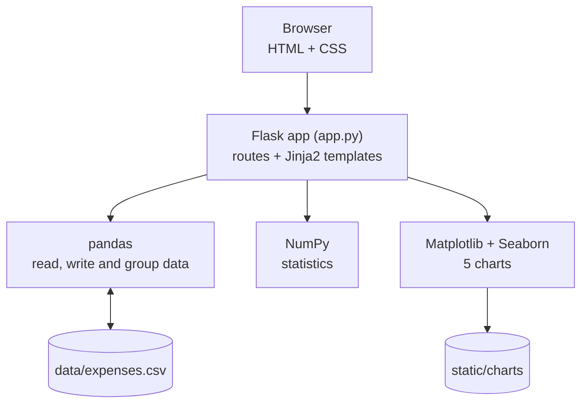

<div align="center">

<h1>CashFlow</h1>

<p><b>A personal expense tracker with a data-analysis dashboard</b></p>


</div>

## Overview

CashFlow is a Flask web app for tracking daily spending. Add, filter, import and export expenses, then open the dashboard to see where your money goes. pandas groups your spending, NumPy calculates the statistics, and Matplotlib and Seaborn draw the charts. Data is stored in a simple CSV file, so no database setup is needed.

## Features

- **Track expenses:** add expenses by date, category, amount and description, filter them by category, and delete them.
- **Dashboard statistics:** total, average, median, highest, lowest and standard deviation.
- **Spending breakdown:** totals by category and by month, with your top spending category highlighted.
- **Five charts:** pie, bar, monthly line, histogram and box plot.
- **CSV import and export:** bulk-add expenses from a CSV file, with column validation, and download all your data in one click.
- **Sample data:** 100 example expenses are included, so the dashboard works straight away.

## Architecture



## Getting Started

```bash
git clone https://github.com/Ashwin-Laad/CashFlow-AI.git
cd CashFlow-AI
pip install -r requirements.txt
python app.py
```

Open [http://127.0.0.1:5000](http://127.0.0.1:5000). To start with an empty tracker, delete `data/expenses.csv` and a new one is created on the next run.

To import expenses, use a CSV file with the columns `date,category,amount,description`. An example is included at `data/sample_expenses.csv`.

## Project Structure

```
CashFlow-AI/
├── app.py              # Routes, analysis and chart generation
├── templates/          # Home, add, expenses, dashboard and import pages
├── static/style.css    # Styling
├── data/               # expenses.csv and sample_expenses.csv
└── requirements.txt
```

## Roadmap

- Monthly budgets with alerts
- Editing existing expenses
- Interactive charts
- Spending forecasts and automatic categorisation

## Author

**Ashwin Laad**: [@Ashwin-Laad](https://github.com/Ashwin-Laad)
